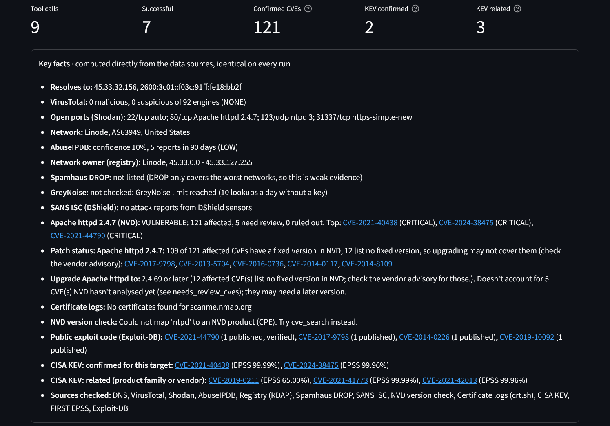
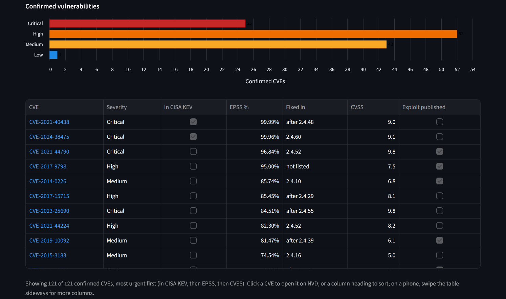

# AI Vulnerability Exposure Analyzer

An AI agent that checks IP addresses, domains, CVEs and software versions for **confirmed vulnerabilities and exposure** across several threat-intelligence sources, then writes an evidence-based security assessment. Cohere's Command A+ model decides which tools to run, and every finding in the report is tied back to the source that produced it.

**Live demo:** [ai-vulnerability-exposure-analyzer.streamlit.app](https://ai-vulnerability-exposure-analyzer.streamlit.app)

**Also available as an MCP server:** [vulnerability-exposure-mcp](https://github.com/MRFrazer25/vulnerability-exposure-mcp) runs the same checks inside Claude, Cursor and other MCP clients, with no Cohere key needed.





## Features

* **Agentic investigation:** the model plans and chains tool calls based on what it finds, within a per-run budget.
* **Version-accurate vulnerability matching:** CVEs are checked against NVD's structured CPE affected-version ranges, so `nginx 1.20.1` is not reported as vulnerable to a bug fixed in 1.20.1. Each CVE is labelled *affected*, *needs review* (NVD hasn't analysed it yet) or *ruled out*, with the fix NVD lists. Recent CVEs NVD hasn't analysed are found too, and for packages such as Next.js, React and Django, GitHub advisories that aren't in NVD yet.
* **Exploit-aware prioritisation:** findings are enriched with [CISA KEV](https://www.cisa.gov/known-exploited-vulnerabilities-catalog) (exploited in the wild), CVSS (v4.0 → v2 fallback), [FIRST EPSS](https://www.first.org/epss/) exploit probability and whether exploit code is published on [Exploit-DB](https://www.exploit-db.com/), and ranked by KEV, then EPSS, then CVSS.
* **Distro-aware patch checks:** for Ubuntu and Debian packages named in banners (e.g. `OpenSSH_8.9p1 Ubuntu-3ubuntu0.6`), the distro's own security data shows which CVEs are already fixed by a backport, so patched servers aren't reported as vulnerable.
* **Exposure and reputation:** Shodan services and banners, VirusTotal engine detections (with the names of flagging vendors), AbuseIPDB abuse reports, Spamhaus DROP, GreyNoise, the network's registered owner, and subdomains from certificate logs.
* **Works without most keys:** only Cohere is required. Without a Shodan key, Shodan's free InternetDB is used, and the key facts list every source that wasn't checked so a skipped lookup is never read as a clean result.
* **Analysis depth levels:** Quick Scan, Standard, Comprehensive and Expert. Each level sets how many tool calls the agent may make, protecting free-tier quotas.
* **Key facts box:** open ports, reputation scores, version-check results, the minimum safe version to upgrade to, and confirmed vs related CISA KEV entries (with EPSS) are computed directly from the data sources and shown above the AI's write-up. They're identical on every run and use no AI credits.
* **Model choice:** pick a Cohere model per analysis, with automatic fallback if your key can't use it.
* **Exports:** a Markdown report, and full JSON evidence including every tool call.

## Supported targets

| Type | Examples |
|---|---|
| IP address (IPv4/IPv6, public only) | `8.8.8.8`, `2606:4700:4700::1111` |
| Domain or URL | `example.com`, `https://example.com/page` |
| CVE ID | `CVE-2026-111497` (Brotli), `CVE-2024-4577` (PHP-CGI, in CISA KEV) |
| Software + version | `PHP 8.3.10`, `nginx 1.30.0`, `Next.js 16.4.0`, `Brotli 1.1.0` |
| Distro package (as a banner shows it) | `OpenSSH 8.9p1 Ubuntu-3ubuntu0.6`, `OpenSSH_9.2p1 Debian-2+deb12u3` |

Private, loopback, link-local, CGNAT and other non-public addresses are rejected.

## Data sources

| Source | Used for | API key | Get a key |
|---|---|---|---|
| [Cohere](https://cohere.com/) | AI agent | **Required** | [dashboard.cohere.com/api-keys](https://dashboard.cohere.com/api-keys) |
| [Shodan](https://www.shodan.io/) | Open ports, services, versions | Optional | [account.shodan.io](https://account.shodan.io/) |
| [VirusTotal](https://www.virustotal.com/) | Reputation / malicious detections | Optional | [virustotal.com/gui/join-us](https://www.virustotal.com/gui/join-us) |
| [AbuseIPDB](https://www.abuseipdb.com/) | Abuse reports for IPs | Optional | [abuseipdb.com/register](https://www.abuseipdb.com/register) |
| [NVD](https://nvd.nist.gov/) | CVE details and affected versions | Optional (raises rate limit) | [nvd.nist.gov/developers/request-an-api-key](https://nvd.nist.gov/developers/request-an-api-key) |
| [CISA KEV](https://www.cisa.gov/known-exploited-vulnerabilities-catalog), [FIRST EPSS](https://www.first.org/epss/) | Exploitation status / probability | Not needed | n/a |
| [GreyNoise](https://www.greynoise.io/) | Internet scanners and known business services | Optional (10 lookups a day without one, then SANS ISC; keys only come with work-email accounts, not Gmail or similar) | [viz.greynoise.io/signup](https://viz.greynoise.io/signup) |
| [OSV.dev](https://osv.dev/) | Ubuntu and Debian fixes for installed packages | Not needed (Ubuntu's data is [CC BY-SA 4.0](https://github.com/canonical/ubuntu-security-notices#license)) | n/a |
| Internet registries (RDAP) | Who an IP's network is registered to | Not needed | n/a |
| [Spamhaus DROP](https://www.spamhaus.org/blocklists/do-not-route-or-peer/) | Hijacked or criminal networks | Not needed (downloaded at most once a day, as Spamhaus asks) | n/a |
| [crt.sh](https://crt.sh/), [Cert Spotter](https://sslmate.com/ct_search_api/) | Subdomains from certificate transparency logs | Not needed | n/a |
| [Shodan InternetDB](https://internetdb.shodan.io/), [Shodan CVEDB](https://cvedb.shodan.io/) | Ports and software without a Shodan key; CVE details when NVD is down | Not needed (free for non-commercial use) | n/a |
| [SANS ISC](https://isc.sans.edu/) (DShield) | Attack reports for an IP when GreyNoise can't answer | Not needed (data is CC BY-NC-SA 4.0, non-commercial) | n/a |
| [Exploit-DB](https://www.exploit-db.com/) | Whether exploit code is published for a CVE | Not needed (index downloaded at most once a day; GPL-2.0-or-later) | n/a |
| [GitHub Advisory Database](https://github.com/advisories) and the [PyPA Advisory Database](https://github.com/pypa/advisory-database) via OSV.dev | Advisories for packages such as Next.js, React and Django before NVD has them | Not needed (data is [CC BY 4.0](https://github.com/github/advisory-database#license)) | n/a |

All of these offer free tiers. Check each provider for its current limits. Free tiers that matter here:

* Cohere trial keys are for evaluation, limited to 1,000 calls a month, and Cohere may use trial inputs and outputs, de-identified, for research ([Cohere's privacy policy](https://cohere.com/privacy)). Use a production key for real or sensitive work: paid accounts are covered by Cohere's [enterprise data commitments](https://cohere.com/enterprise-data-commitments), including a training opt-out.
* VirusTotal's free public API allows 4 lookups a minute and 500 a day, and [must not be used in commercial products or services](https://docs.virustotal.com/reference/public-vs-premium-api).
* AbuseIPDB's [free plans](https://www.abuseipdb.com/legal) are for non-commercial personal projects, and its data must not be republished.
* Shodan's InternetDB and CVEDB are free for non-commercial use only.
* Spamhaus DROP is free, but [Spamhaus must be credited](https://www.spamhaus.org/drop/terms/) when it's used in a product.

This product uses data from the NVD API but is not endorsed or certified by the NVD.

Spamhaus DROP data is (c) The Spamhaus Project. Package advisories are from the GitHub Advisory Database (CC BY 4.0), the PyPA Advisory Database (CC BY 4.0) and Ubuntu's security notices (CC BY-SA 4.0, (c) Canonical), all via OSV.dev; SANS ISC data is CC BY-NC-SA 4.0. CVE® is a registered trademark of The MITRE Corporation.

This is an independent project, not affiliated with, endorsed by or sponsored by Cohere, Shodan, VirusTotal (Google), AbuseIPDB, NIST, CISA, FIRST, MITRE, Spamhaus, GreyNoise, SANS, OffSec (Exploit-DB), GitHub, Google (OSV.dev), Sectigo (crt.sh), SSLMate (Cert Spotter) or the internet registries. Their names are used only to say which services it works with.

## Running locally

Requires Python 3.11+. Or skip setup and use the live demo linked at the top.

```bash
git clone https://github.com/MRFrazer25/ai-vulnerability-exposure-analyzer.git
cd ai-vulnerability-exposure-analyzer
python -m venv .venv
.venv\Scripts\activate          # macOS/Linux: source .venv/bin/activate
python setup_check.py
```

`setup_check.py` installs or upgrades the requirements, verifies the imports, creates `.env` from `.env.example`, and prints where to get each key. Get a [Cohere key](https://dashboard.cohere.com/api-keys) (required) plus any optional keys from the table above. Enter them in the app under API Keys Configuration: they're kept for that browser session only and never saved to disk. Then start the app:

```bash
python -m streamlit run app.py
```

Open http://localhost:8501.

### Choosing a Cohere model

**Why Cohere?** Cohere's free trial keys let anyone try the app without paying, and its Command A models are built for the multi-step tool use this agent depends on. To use the same checks with Claude, Cursor or another AI client, see the [MCP server](https://github.com/MRFrazer25/vulnerability-exposure-mcp).

Pick the model in the app, next to "Analysis depth". Only models that support tool use are offered:

| Model | Best for |
|---|---|
| `command-a-plus-05-2026` (default) | Most capable; recommended |
| `command-a-03-2025` | Proven and stable |
| `command-a-reasoning-08-2025` | Harder analyses; slower because it reasons first |

If your key can't use the chosen model, the analysis falls back to `command-a-03-2025` automatically and tells you. The model that actually ran is shown with every report. To change the default, set `COHERE_MODEL` in `.env`.

### Tests

```bash
pip install pytest
python -m pytest
```

The tests run offline. They cover target validation, version comparison (including trailing zeros such as `2.4` vs `2.4.0`), NVD range matching, minimum safe versions, KEV and keyword matching, Markdown sanitising and export escaping, NVD cache/rate-limit behaviour, keys staying per session, and the agent loop (using a fake Cohere client). Many are regression tests built from real analysis runs.

## How it works

1. **Classify** the input as an IP, domain, CVE or software, rejecting anything invalid or non-public.
2. **Baseline lookups (in code):** for IPs and domains, DNS, Shodan, VirusTotal, AbuseIPDB, the registry owner and the Spamhaus/GreyNoise threat lists always run before the AI starts, so core coverage never depends on the model. The keyless owner and threat-list lookups don't count against the tool budget. Shodan results are automatically checked against CISA KEV, including products named only in service banners.
3. **Investigate:** the agent chooses further tools (NVD version check, distro patch check, NVD lookup, CISA KEV, keyword search, subdomains). Duplicate calls are served from cache, and quota-limited services are capped per run. Keyword searches keep only CVEs that mention the term as a whole word.
4. **Verify versions:** for each product and version, CVEs come from NVD's CPE match API and are then re-checked locally against each affected range. The minimum safe version is computed from the range ends. When a banner names an Ubuntu or Debian package, the distro's data overrides NVD's verdict for CVEs it has already fixed.
5. **Report:** code builds the Key facts and the table and chart of confirmed CVEs. The model writes an executive summary, a key-findings table, details (Confirmed / Related / Needs Review / Ruled Out), prioritised recommendations and limitations, citing a source for every claim.
6. **Check:** code compares the report with the data and shows a warning for anything it doesn't support, such as a CVE ID no lookup returned (looked up in NVD to tell a real one from a wrong one), a misquoted fix version, an unconfirmed CVE filed as confirmed, or an exploit claim the data doesn't back.

## Security and privacy

* **Per-session API keys:** keys entered in the UI live only in that user's Streamlit session. They are never written to environment variables or disk, and never shared between users of a deployment. The app never uses keys from `.env`, environment variables or Streamlit secrets, so whoever hosts it can't have their keys used by visitors, and each visitor's analyses run only on the keys they entered.
* **Safe rendering:** the report includes third-party text (banners, descriptions), so it is rendered as Markdown only. Raw HTML is not rendered. Remaining `[`, `]` and `<` in the model's write-up are escaped so reference images, hidden links and HTML cannot survive, and third-party software names in the Markdown export are escaped the same way as on screen.
* **Prompt-injection hardening:** tool output is treated as untrusted data and kept inside escaped data blocks. Results are size-capped before they reach the model, and the model can't override server-side limits through tool arguments.
* **Input validation:** CVE IDs, domains and IPs are validated before any API call, and query parameters are URL-encoded.
* **Key redaction:** error messages are scrubbed of API key values.
* **No telemetry:** Streamlit usage stats are disabled, stack traces are hidden from visitors, and analysed targets are not written to server logs.

**What leaves your machine:** the target and the gathered evidence are sent to Cohere to produce the report. The target is also looked up at whichever sources apply: Shodan, VirusTotal, AbuseIPDB, NVD, FIRST, GreyNoise or SANS ISC, the internet registries, OSV.dev, and crt.sh or Cert Spotter. CISA's KEV catalog, Spamhaus DROP and the Exploit-DB index are downloaded whole, so no target is sent to them. Each lookup is subject to that provider's privacy policy, and each provider also sees the requesting IP address: Shodan, NIST, CISA and FIRST say they log details such as the IP and time of each request. With a Cohere trial key, Cohere may use the target and evidence, de-identified, for research. Don't submit targets you need to keep confidential.

Exported reports can contain sensitive findings. Handle them accordingly.

## Accuracy notes

* Banner versions can mislead. Linux distributions often backport security fixes without changing the version string. The distro patch check handles Ubuntu and Debian packages whose banner includes the package version (mainly OpenSSH); for others, such as Apache or nginx on Ubuntu and anything on Red Hat, verify findings against your distribution's security tracker.
* "No known vulnerabilities" means no matching NVD records, not that a system is secure.
* A product-level CISA KEV match shows that the product has been exploited before, not that the target's version is affected.
* Testing so far has focused on common software and devices, so results for less common products may be less reliable. If a result looks wrong, please [open an issue](https://github.com/MRFrazer25/ai-vulnerability-exposure-analyzer/issues) with the target you used.

## License

MIT. See [LICENSE](LICENSE).

## Disclaimer

For legitimate security research, defensive security and education only. Only investigate systems you own or are authorized to assess, and follow each data provider's terms of service.
